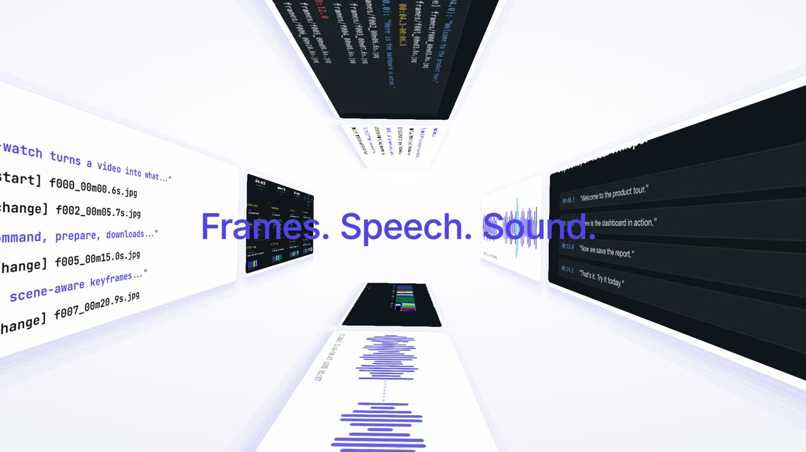
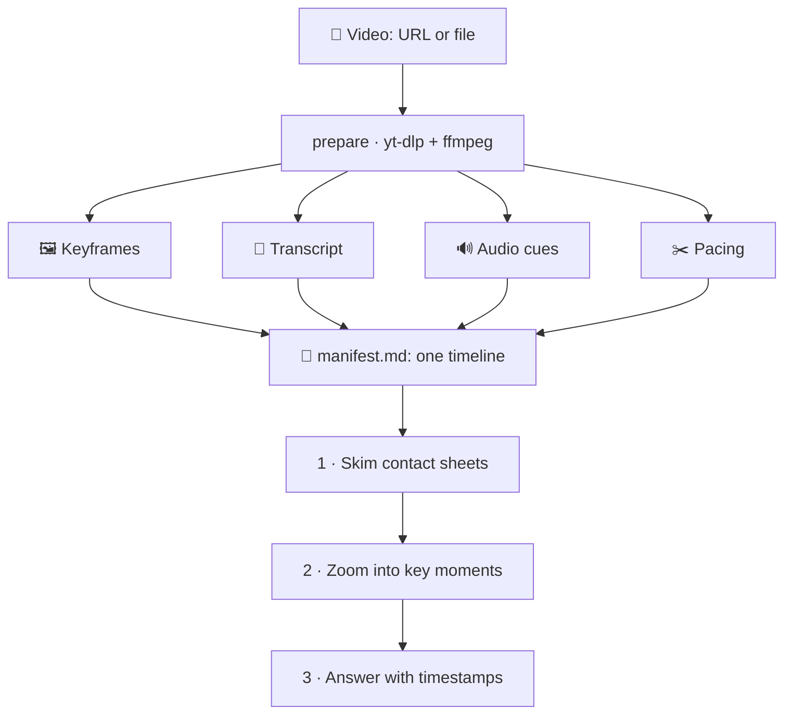

<div align="center">

# ▶︎ video-watch

**Claude can't take a video file directly. Now it can watch one.**

A Claude Code plugin that turns any video (a YouTube link, any URL, or a local file) into what a person actually notices: the moments the picture changes, what's said and when, and what the sound is doing. Claude then skims, rewinds and answers with a timestamp for every claim.

[](.claude-plugin/plugin.json)
[](#install)
[](#requirements)
[](skills/watch/scripts/vw.py)

<br>

[](media/launch-ad-v2.mp4)

<sub>▲ The launch ad. Click to play. It was built from a production prompt that this plugin wrote ([see how](#remake-any-video-in-your-own-style)).</sub>

</div>

---

## Install

In Claude Code:

```
/plugin marketplace add gowtham012/video-watch
/plugin install video-watch@video-watch
```

Then install the two tools it relies on (macOS):

```bash
brew install ffmpeg yt-dlp
```

That's it. To try a local checkout instead, start Claude Code with `claude --plugin-dir /path/to/video-watch`.

## Use it

Paste a link and ask anything, or call the skill directly:

```
/video-watch:watch https://youtube.com/watch?v=...   critique this as a launch video
/video-watch:watch ~/Desktop/bug.mov                 what goes wrong after login?
watch this talk and give me the 5 key arguments: https://youtu.be/...
```

If you paste a link without saying what you want, Claude gives you the gist and a timeline, then asks what to do next:

| Option | What you get |
|---|---|
| 🎬 **Remake it with my content** | Same style and quality, your product. See [below](#remake-any-video-in-your-own-style). |
| 🧐 **Critique it** | A hook, pacing and CTA scorecard, plus the top fixes, all timestamped. |
| 📝 **Detailed summary** | Key points and takeaways. |
| 💻 **Pull out text, code or steps** | Verbatim, from the frames. |

## How it watches



| A person… | video-watch… |
|---|---|
| **notices when the picture changes** | scans the whole video at low resolution and keeps one frame per settled visual state, not a fixed one-frame-every-N-seconds grid. |
| **listens to what's said** | uses YouTube captions or `.vtt`/`.srt` files and falls back to local Whisper. Every line keeps its timestamp. |
| **feels the sound** | measures silence, sound with no speech (music, effects) and loud hits from the waveform. |
| **senses the pace** | counts hard cuts, average shot length, and where the cuts bunch up. |
| **skims, then rewinds** | gives Claude labelled contact sheets for a cheap first pass, then `zoom` and `frame --crop` for close-ups. |

## Remake any video in your own style

Show it a video you love and say **"make one like this for my product."** The plugin pulls the video's style apart from the evidence:

- **Structure:** every shot's exact in and out time, from dense zooms across each scene boundary.
- **Rhythm:** the tempo, estimated from where cuts and loud hits land.
- **Colour:** exact hex values measured from the frames, each given a role (background, text, primary, highlight).
- **Type and motion:** weight, size, how words enter, easing, stagger, camera moves and transitions.

It then writes a **production prompt** that rebuilds that quality around your content: a master brief, a shot list with exact timings, a Remotion build plan, a music brief and a quality checklist. It copies the style only, never the original's logos, footage, copy or music.

> [`media/remake-prompt.md`](media/remake-prompt.md) is a real example: it reverse-engineers a SaaS launch ad. The video at the top of this page was built from it, and the code is in [`launch-video/`](launch-video/).

## Numbers

All of these were measured on a MacBook (Apple Silicon) while testing this release.

| Measure | Result |
|---|---|
| ⚡️ **Prepare time** | about 6 s for a 3–5 minute 720p video, about 9 s for a 10-minute 1080p video |
| 🪙 **Cost to read** | about 7k image tokens (contact sheets only) to 27k (every frame) for a 10-minute video |
| 🎯 **Timing accuracy** | cuts, silences and loud hits reported within 0.1 s on test clips |
| 🎨 **Colour accuracy** | `colors` lands within one 8-level step of the true hex |

## Commands

The skill drives all of this for you. You can also run the script directly:

```bash
VW="python3 skills/watch/scripts/vw.py"

$VW prepare <url|file> --out ./vw-x [--start 1:00 --end 2:30] [--max-frames 60] [--sensitivity 2]
$VW zoom    --dir ./vw-x --start 1:10 --end 1:14 --fps 6 [--crop x,y,w,h]   # dense frames + speech in a window
$VW frame   --dir ./vw-x --at 1:12.5 [--crop 0.5,0,0.5,0.5]                 # one sharp close-up
$VW colors  --dir ./vw-x [--at 0:03,0:12]                                   # measured palette, as hex
```

<details>
<summary><b>Tuning tips</b></summary>

- **Screen recordings and UI demos:** `--sensitivity 3` catches small changes, down to a single text label.
- **Fast-cut ads:** `--max-frames 80`.
- **Talks over 20 minutes:** `--max-frames 40`, then zoom where it matters.
- **Videos over 45 minutes with a specific question:** pass `--start`/`--end`.
- **Crop values** are fractions of the frame: `0.5,0,0.5,0.5` is the top-right quarter.

</details>

## Requirements

| Need | Install |
|---|---|
| **Required** | `ffmpeg` + `ffprobe`, and `yt-dlp` for links: `brew install ffmpeg yt-dlp` |
| Optional | `pip install pillow` for contact sheets (a cheaper first pass) |
| Optional | `pip install mlx-whisper` (Apple Silicon) or `faster-whisper`, for videos without captions. Set `VW_WHISPER_MODEL=small` for better accuracy. |
| YouTube bot checks | `export VW_COOKIES_BROWSER=chrome` (or `safari`) |

## Honest limits

- **Audio is measured, not heard.** It knows loud, silent and "music, no speech", but not what a melody is or how a voice feels.
- **Between keyframes is unseen** until Claude zooms in. Fast action, counting and sports plays need a zoom.
- **Very long videos thin out.** Ask about a time range instead.
- **Only process videos you have the right to download.**

## What's in the repo

```
.claude-plugin/        plugin + marketplace manifests
skills/watch/          the skill: SKILL.md, viewing lenses, and scripts/vw.py
media/                 all videos (launch ad v1 + v2, how-it-works explainer), poster, example remake prompt
media/build/           scripts + demo clip that rebuild the videos
launch-video/          Remotion source for the launch ad v2 (not part of the plugin)
docs/                  research verdict from the multi-agent viability review
```

<div align="center">
<br>

**Skim. Zoom. Answer.**

<sub>Made by Gowtham · built with Claude Code</sub>

</div>
